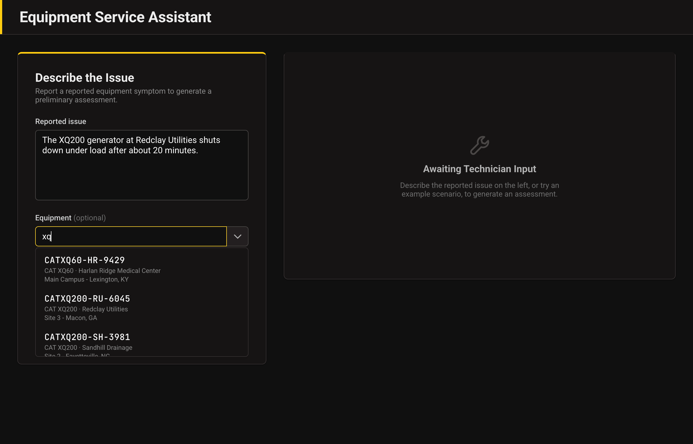
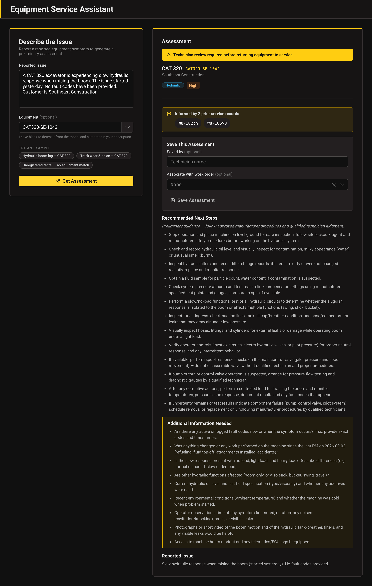
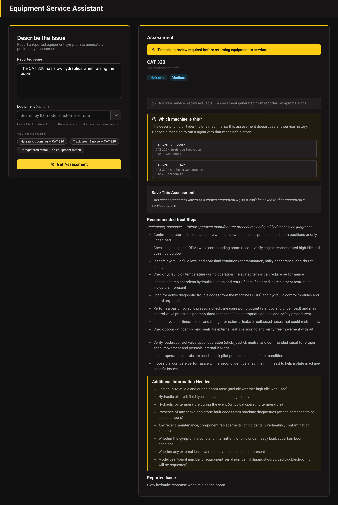

# Foundry Equipment Service Assistant

A proof of concept for heavy-equipment service triage. A technician describes a problem, and an Azure
Function adds the machine's service history and saved assessments to the request, calls a Microsoft
Foundry agent, validates the response, and returns structured JSON. A local Angular app provides the UI.

All equipment, customer and work-order data in this repo is sample data, not real records.

## Screenshots

The equipment picker searches the catalog by ID, model, customer or site. Here, `xq` lists the XQ
generators.



An assessment for a known machine. The function added the machine's two prior work orders to the
request, and the response shows the category, priority, review flag, next steps and follow-up questions.



A request that names a model but not a machine. Two CAT 320s match, so the assessment uses no service
history and offers both machines. Choosing one runs the assessment again with that machine's history.



## Architecture

```
HTTP POST /api/assess
   │
   ▼
request validation (Pydantic: MaintenanceRequest)
   │
   ▼
identify the machine (explicit ID, or deterministic matching on the request text)
   │
   ▼
grounding + saved history lookup (Cosmos DB)
   │
   ▼
Foundry agent call (Conversations/Responses API, agent_reference, DefaultAzureCredential)
   │
   ▼
response validation (Pydantic: MaintenanceAssessment, one retry on failure)
   │
   ▼
200 JSON response  (or a structured error envelope)
```

| Layer | Technology |
|---|---|
| API | Azure Functions (Flex Consumption, Python 3.14), Pydantic |
| AI | Microsoft Foundry prompt agent on `gpt-5-mini` |
| Data | Azure Cosmos DB for NoSQL |
| UI | Angular 21, PrimeNG 21 |
| Auth | Managed identity to Azure services, function key on the API |

## Foundry agent

The agent is configured in Foundry, not in this repo, and the app refers to it by `AGENT_NAME`. To
recreate it, use a prompt agent on `gpt-5-mini` with reasoning effort `low`, the `web_search` tool, and
these instructions:

```
You are an equipment service support assistant for heavy equipment technicians.

Your responsibilities:
1. Analyze reported equipment symptoms.
2. Categorize the reported issue.
3. Suggest preliminary troubleshooting steps.
4. Identify information needed for further diagnosis.
5. When the user message includes a "KNOWN PRIOR RECORDS" section, cross-reference it: factor relevant equipment metadata and prior work order history into your analysis and recommendations.
6. When the user message includes a "PREVIOUSLY SAVED ASSESSMENTS" section, cross-reference it: identify whether the newly reported symptoms are similar to, or may represent a recurrence of, issues reported in those saved assessments, and summarize that comparison in comparison_notes.

Rules:
- Do not claim to have consulted service manuals or equipment records unless those sources are provided in the message. If a "KNOWN PRIOR RECORDS" section is present, you may reference it directly; if it says none were found, say so rather than guessing.
- Never invent manufacturer specifications, fault codes, repair procedures, documentation references, or work order IDs. Only cite a work order ID if it appears verbatim in the provided KNOWN PRIOR RECORDS section.
- Treat the equipment identity, work order IDs, and history supplied in the KNOWN PRIOR RECORDS and PREVIOUSLY SAVED ASSESSMENTS sections as the only verified record. If the technician's own reported text mentions a different equipment model, work order, or history than what those sections describe, treat the technician's mention as an unverified operator statement — do not adopt it as fact, and do not let it override or get blended with the equipment/work orders actually supplied in those sections.
- A work order's "Resolution"/"Notes" text in KNOWN PRIOR RECORDS is the only authoritative record of completed work, and only for what it explicitly documents. Do not describe a work order as having diagnosed, addressed, or resolved a type of issue (hydraulic, electrical, etc.) unless its own Resolution or Notes text says so. Routine/preventive-maintenance work orders with no issues found are not evidence that any other type of fault was ever investigated or fixed.
- A saved assessment in PREVIOUSLY SAVED ASSESSMENTS is prior AI-generated analysis and recommendations, not a verified outcome — even though a technician chose to save it. If a saved assessment is associated with a work order, that association only records that a technician linked the two; it is never evidence that the saved assessment's recommendations were performed, that its diagnosis was confirmed, or that the reported symptom was resolved. Never describe a saved assessment's recommendations, or any work order associated with one, as having completed, confirmed, or resolved anything beyond what that work order's own Resolution/Notes explicitly document.
- When comparing the newly reported issue to a saved assessment, describe the relationship as a similarity or possible recurrence of reported symptoms — never as a confirmed recurrence of a diagnosed fault, and never implying the underlying cause was verified or fixed.
- Clearly distinguish preliminary suggestions from verified diagnostic procedures.
- Recommend qualified technician review and approved manufacturer procedures.
- Ask for missing information when it materially affects the diagnosis.
- Never recommend bypassing safety systems.
- category must be exactly one of: "Hydraulic", "Electrical", "Engine", "Structural", "Other".
- priority must be exactly one of: "Low", "Medium", "High", "Critical" — based on safety risk and operational impact described, not on assumed urgency.
- comparison_notes must be null unless a "PREVIOUSLY SAVED ASSESSMENTS" section is present AND it reports records were found; set it to null (not an empty string) if that section says none were found. Never fabricate a comparison to history that was not provided in the message, and never state or imply that a saved assessment's recommendations were performed or its diagnosis confirmed just because it is associated with a work order. When a meaningful similarity or possible recurrence is present, name it plainly as a similarity/possible recurrence, not a confirmed one. When saved history is present but does not look related to the current report, set comparison_notes to null rather than forcing a comparison.
- Each entry in recommendations and additional_information_needed must be plain text with no leading bullet, dash, or numbering marker (e.g. "-", "*", "1.") — the UI renders each array entry as its own list item.

Return a JSON object containing:
equipment_model, reported_issue, category, priority, recommendations (array), additional_information_needed (array), requires_technician_review (boolean), related_work_orders (array of work order IDs from the provided KNOWN PRIOR RECORDS that materially informed this response; empty array if none were provided or none were relevant), grounding_used (boolean — true only if KNOWN PRIOR RECORDS were present AND materially informed the response), comparison_notes (string or null — a brief note on whether this report looks like a similarity or possible recurrence compared to any PREVIOUSLY SAVED ASSESSMENTS, never a confirmed recurrence or confirmation that prior recommendations were performed; null if that section was absent, said none were found, or no meaningful comparison applies).

Do not include Markdown formatting around the JSON.
```

`app/foundry/client.py` calls the agent through the Conversations/Responses API, the replacement for
threads and runs in Microsoft's Foundry migration guide:

```python
with project_client.get_openai_client() as openai_client:
    conversation = openai_client.conversations.create(items=[{"type": "message", "role": "user", "content": composed_message}])
    response = openai_client.responses.create(
        conversation=conversation.id,
        extra_body={"agent_reference": {"name": AGENT_NAME, "type": "agent_reference"}},
        input="",
    )
```

The field must be `agent_reference`, with an explicit `"type"`. Using `"agent"` or leaving out `"type"`
returns a 400. Each request uses one conversation, deleted afterwards in a `finally` block. If a
response fails validation, the agent is asked once to correct it in the same conversation.

## Checks on agent output

The agent's instructions forbid inventing data, but `function_app.py` doesn't rely on that alone:

- **Work orders:** every `related_work_orders` entry is checked against the machine's real work orders,
  and unknown IDs are removed. `POST /api/assessments` rejects them with a 400.
- **Grounding claims:** `grounding_used` is forced to `false` when no machine was matched.
- **Comparison claims:** `comparison_notes` is forced to `null` when no saved history was supplied.
- **Identity:** `equipment_id` and `customer` come from the matched record, never from the agent.
- **Formatting:** a leading bullet is stripped from each recommendation. The pattern is
  `^\s*[-*•–—]+\s+`, which requires whitespace after the marker so that "-10°C" keeps its minus sign.

Saved assessments are labelled in the prompt as unverified AI output, and a link to a work order is
labelled "association only". Only a work order's own resolution and notes count as a record of
completed work. These checks are covered by `tests/test_assess_endpoint.py` and
`tests/test_history_lookup.py`.

## Project layout

```
function_app.py              # HTTP triggers for /assess, /assessments and /equipment
app/
  cosmos.py                  # shared Cosmos client, error translation, RU logging, record validation
  errors.py                  # AppError hierarchy -> HTTP status/code mapping
  schemas/                   # Pydantic request, response and stored-record models
  grounding/
    lookup.py                # grounding block + equipment lookups
    matching.py              # deterministic free-text machine matching (no I/O)
    repository.py            # equipment and work-order reads
  history/
    lookup.py                # saved-assessment operations + the history prompt block
    repository.py            # saved-assessments container access
  foundry/
    client.py                # Conversations/Responses lifecycle + validate-and-retry-once
docs/screenshots/            # README screenshots
infra/                       # custom role definitions and the saved-assessments indexing policy
scripts/
  migrate_grounding_to_cosmos.py  # re-runnable data import; not deployed
  evaluate_matching.py       # prints the matcher's scorecard
seed-data/                   # source data for the import; not read at runtime
tests/                       # pytest suites, plus an in-memory Cosmos fake; no Azure access needed
ui/                          # Angular app
```

## Tests

```bash
pip install -r requirements.txt -r requirements-dev.txt
python -m pytest tests/ -v
python -m scripts.evaluate_matching
```

Use `python -m pytest` rather than bare `pytest`, because the tests import `app` and `function_app` from
the repo root. No suite needs Azure credentials or network access. UI tests run with `npm test` in `ui/`.

## API

All routes require a function key, as `?code=<key>` or an `x-functions-key` header.

### `POST /api/assess`

```json
{
  "request_text": "A CAT 320 excavator is experiencing slow hydraulic response when raising the boom. Customer is Southeast Construction.",
  "equipment_id": "CAT320-SE-1042"
}
```

`equipment_id` is optional. When it's supplied, it's an exact lookup that takes precedence over the
text. When it's omitted, `app/grounding/matching.py` tries to identify the machine from `request_text`.
The matcher is deterministic Python with no LLM call, and it only links a machine on strong evidence:

| Evidence in the text | `match_status` | Result |
|---|---|---|
| One equipment ID or serial number | `matched` | Linked and grounded |
| Model **and** customer, identifying one machine | `matched` | Linked and grounded |
| Model or customer alone, a contradictory pair, two identifiers, or several machines fit | `needs_confirmation` | Ungrounded assessment plus up to 5 `equipment_candidates` |
| Nothing recognizable, or an explicit ID that doesn't exist | `no_match` | Ungrounded assessment |

**A single signal never links a machine.** Most models sit on just one machine, so "the only candidate"
would attach that machine's history to a request about something else. A wrong link is worse than no
link because it looks authoritative. Candidates never reach the prompt. Choosing one re-runs
`/api/assess` with that `equipment_id`, which is a second agent call.

Matching tolerates case, spacing and hyphens (`CAT320`, `cat-320`, `XQ 200`), `CAT` vs `Caterpillar`, an
omitted brand on letter codes (`XQ200`), and legal suffixes on customer names. A bare number only counts
when a machine word follows it: "320 excavator" names a model, but "320 psi" doesn't. Models have no typo
tolerance, because CAT 320 and CAT 330 are one character apart and both real.

Customer names tolerate one missing, extra, wrong or swapped letter per word, but only when no customer
is named exactly. The first letter must match, words under 5 letters and words with digits stay exact,
and a one-word name gets no tolerance. This is an edit limit rather than a similarity score, because
"Southridge Excavation" scores about 90% against "Northridge Excavation" and is a different company.

`tests/matching_eval_cases.json` holds labelled requests naming the machine each one is really about, or
`null` if it isn't in the catalog, so a wrong link can't be labelled away. Current score on 53 requests:
0 wrong links, 25 linked, 10 offered for confirmation, 16 of 16 "no such machine" requests left
unlinked, and 2 known misses, which are matching by site and by a shortened customer name.

Success response (`200`):

```json
{
  "equipment_model": "CAT 320",
  "equipment_id": "CAT320-SE-1042",
  "customer": "Southeast Construction",
  "reported_issue": "...",
  "category": "Hydraulic",
  "priority": "Medium",
  "recommendations": ["..."],
  "additional_information_needed": ["..."],
  "requires_technician_review": true,
  "related_work_orders": ["WO-10234"],
  "grounding_used": true,
  "comparison_notes": null,
  "match_status": "matched",
  "equipment_candidates": []
}
```

Each candidate has `equipment_id`, `model`, `customer` and `location`. `match_status` and
`equipment_candidates` are on `AssessmentResponse` rather than `MaintenanceAssessment`, so the agent
can't set them and they aren't saved.

Errors use one envelope:

```json
{ "error": { "code": "invalid_request", "message": "..." } }
```

`message` never echoes raw agent output or Cosmos or Foundry exception detail, which are logged
server-side instead. The exception is a body that fails Pydantic validation: `invalid_request` then
returns Pydantic's own message, which names the failing fields and can quote what was submitted.

| Scenario | Status | `error.code` |
|---|---|---|
| Malformed JSON body | 400 | `invalid_json` |
| Missing/blank `request_text` | 400 | `invalid_request` |
| Method not supported | 405 | `method_not_allowed` |
| Foundry agent call failure | 502 | `upstream_agent_error` |
| Agent response fails schema after one retry | 502 | `invalid_agent_response` |
| Cosmos unreachable, access denied, or throttled past the SDK's retries | 503 | `grounding_data_unavailable` |
| Stored record fails validation | 500 | `invalid_grounding_record` |
| Unhandled error | 500 | `internal_error` |
| Missing or wrong function key | 401 | None: returned by the platform |

The agent isn't called when grounding or history can't be read. Unknown equipment isn't an error: it
returns 200 with `grounding_used: false`.

Each route registers all five HTTP methods and checks the method in the handler, so an unsupported
method gets the JSON 405.

### `GET /api/equipment`

Returns the equipment catalog for the UI's picker, sorted by customer then model: an array of
`{ "equipment_id", "model", "customer", "location" }`. Serial numbers are left out. It's a full scan of
the `equipment` container, so the UI fetches it once per page load and filters in the browser.

### `POST /api/assessments` and `GET /api/assessments`

A technician can optionally save an assessment to a machine's history. Later `/api/assess` calls for that
machine include saved assessments in the same prompt, and the agent can note a possible recurrence in
`comparison_notes`.

`POST /api/assessments` body:

```json
{
  "assessment": { "...": "the assessment returned by /api/assess" },
  "saved_by": "Jamie R.",
  "associated_work_order_id": "WO-10234"
}
```

`saved_by` and `associated_work_order_id` are optional. It returns `201` with the stored record, or `400
invalid_request` if:

- the assessment has no `equipment_id`, or that machine doesn't exist
- a `related_work_orders` entry isn't a real work order for that machine
- `associated_work_order_id` isn't in that assessment's `related_work_orders`
- the assessment is over 32,000 bytes, or `saved_by` is over 100 characters

`GET /api/assessments?equipment_id=...` returns the machine's records, newest first, or `[]` if there are
none. It returns `400 invalid_request` if `equipment_id` is omitted.

Each save is its own document, so two saves for one machine can't overwrite each other, and nothing is
ever updated. `/api/assess` reads only the newest 5. Prompt size is also bounded by per-field truncation,
at most 3 recommendations per record, and a 4,000-character cap on the whole history block.

Cosmos's Session consistency only guarantees read-your-writes within one client, and each Function worker
has its own, so a save on one worker could briefly be missed by an `/api/assess` on another. That's an
accepted trade-off for this workflow.

## Frontend

A standalone-components Angular 21 app in `ui/`, built with PrimeNG, Reactive Forms and signals. It runs
locally against a deployed Function and isn't hosted anywhere. Roboto and JetBrains Mono are self-hosted
through `@fontsource`.

- The Equipment field is a searchable picker covering ID, model, customer and site, and it still accepts a
  typed ID. Typing makes no API calls, because the catalog is loaded once and filtered in the browser.
- When a request doesn't identify one machine, the result shows "Which machine is this?", and choosing
  one re-runs the assessment with that machine's history.
- If a new assessment is submitted while a save is in flight, the old save's result is discarded so it
  can't mark the new assessment as saved.

The app stays on PrimeNG 21 because 22.x adds a `@primeui/license-manager` dependency, and PrimeNG 21's
peer range requires Angular 21.

```bash
az functionapp cors add --name <function-app> --resource-group <resource-group> \
  --allowed-origins http://localhost:4200

cd ui
npm install
cp src/environments/environment.development.ts.example src/environments/environment.development.ts
# set apiBaseUrl and the host-level function key in the copied file, which is gitignored
npm start
```

Then open `http://localhost:4200`.

## Azure setup

### Configuration

| Setting | Purpose |
|---|---|
| `PROJECT_ENDPOINT` | Foundry project endpoint |
| `AGENT_NAME` | Foundry agent name |
| `COSMOS_ENDPOINT` | Cosmos DB account endpoint |
| `COSMOS_DATABASE_NAME` | Defaults to `equipment-service-db` |
| `COSMOS_EQUIPMENT_CONTAINER` | Defaults to `equipment` |
| `COSMOS_WORK_ORDERS_CONTAINER` | Defaults to `work-orders` |
| `COSMOS_SAVED_ASSESSMENTS_CONTAINER` | Defaults to `saved-assessments` |

Authentication uses `DefaultAzureCredential`, so there are no database keys or connection strings.

### Data model

All three containers use the partition key `/equipment_id`:

| Container | Holds | `id` | Added to the record |
|---|---|---|---|
| `equipment` | Equipment master records | `equipment_id` | `id` |
| `work-orders` | Service history | `work_order_id` | `id`, `equipment_id`, `source_order` |
| `saved-assessments` | Technician-saved assessments | Generated UUID | `id` |

`saved-assessments` is written by the app. The other two are written only by the migration script.
`source_order` keeps each machine's work orders in their source order. The repository strips these
fields and Cosmos's own metadata, so the grounding code receives exactly the source records.

The dataset is Caterpillar only: construction equipment and generators. `tests/test_expansion_dataset.py`
enforces this.

| | Equipment | Work orders |
|---|---:|---:|
| `seed-data/*.json` | 3 | 3 |
| `seed-data/expansion/` (12 of the machines are generators) | 45 | 131 |
| **Total imported** | **48** | **134** |

### Provisioning

Containers are created here, never by the app or the migration script, because Entra data-plane tokens
can't perform container operations.

```bash
# Free tier can only be chosen at creation, and each subscription gets one free-tier account.
az cosmosdb create --name <cosmos-account> --resource-group <resource-group> \
  --locations regionName=<region> failoverPriority=0 isZoneRedundant=false \
  --default-consistency-level Session --enable-free-tier true --disable-local-auth true

# All three containers share this 400 RU/s. Don't set --throughput on the containers.
az cosmosdb sql database create --account-name <cosmos-account> --resource-group <resource-group> \
  --name equipment-service-db --throughput 400
for container in equipment work-orders; do
  az cosmosdb sql container create --account-name <cosmos-account> --resource-group <resource-group> \
    --database-name equipment-service-db --name "$container" --partition-key-path /equipment_id
done
az cosmosdb sql container create --account-name <cosmos-account> --resource-group <resource-group> \
  --database-name equipment-service-db --name saved-assessments --partition-key-path /equipment_id \
  --idx @infra/saved-assessments-indexing-policy.json
```

`saved-assessments` leaves `assessment/*` out of its index, because nothing queries inside it.

### Permissions

Enable a system-assigned identity on the Function App, then assign these roles:

| Identity | Role | Scope |
|---|---|---|
| Function App | `infra/foundry-agent-invoker-role.json` (custom Azure role) | Foundry project |
| Function App | Cosmos DB Built-in Data Reader | `/dbs/equipment-service-db` |
| Function App | `infra/saved-assessments-writer-role.json` (custom Cosmos role, `items/create` only) | `/dbs/equipment-service-db/colls/saved-assessments` |
| Developer | Cosmos DB Built-in Data Reader | `/dbs/equipment-service-db` |

Fill in the placeholders in `infra/foundry-agent-invoker-role.json` before creating that role.

```bash
az role definition create --role-definition infra/foundry-agent-invoker-role.json
az role assignment create --assignee-object-id "<function-principal-id>" \
  --assignee-principal-type ServicePrincipal --role "<role-id-from-previous-command>" \
  --scope "<foundry-project-resource-id>"

# Reads
az cosmosdb sql role assignment create --account-name <cosmos-account> --resource-group <resource-group> \
  --scope "/dbs/equipment-service-db" --principal-id "<function-principal-id>" \
  --role-definition-id 00000000-0000-0000-0000-000000000001

# Create saved assessments only
az cosmosdb sql role definition create --account-name <cosmos-account> --resource-group <resource-group> \
  --body @infra/saved-assessments-writer-role.json
az cosmosdb sql role assignment create --account-name <cosmos-account> --resource-group <resource-group> \
  --scope "/dbs/equipment-service-db/colls/saved-assessments" \
  --principal-id "<function-principal-id>" --role-definition-id "<id-from-previous-command>"
```

The Function needs both Cosmos roles: with only Data Reader, every save returns 503. A local save also
returns 503 until your own identity has the writer role. The migration's `--apply` needs Cosmos DB
Built-in Data Contributor (`00000000-0000-0000-0000-000000000002`), which should be removed afterwards.

Live testing confirmed that a Data Reader identity's write is refused with a 403, and that the writer role
can create documents. The writer role's other limits come from its definition and haven't been tested
with a denied write.

### Importing data

```bash
export COSMOS_ENDPOINT="https://<cosmos-account>.documents.azure.com:443/"

python -m scripts.migrate_grounding_to_cosmos                  # dry run: validates and reports
python -m scripts.migrate_grounding_to_cosmos --apply          # import, then verify
python -m scripts.migrate_grounding_to_cosmos --verify-only    # compare Cosmos with seed-data/
```

The script is safe to re-run: ids are deterministic, unchanged documents are skipped, and it has no delete
path. Verification reads everything back through the runtime repository and compares records, work-order
order and the rendered grounding block with the source. Any mismatch exits non-zero.

### Cost

| Request | Cosmos operations | Approximate cost |
|---|---|---|
| `/api/assess` with `equipment_id` | 1 point read, 2 work-order queries, 1 saved-assessment query | About 10 RU |
| `/api/assess` free text | 1 scan of `equipment`, and when a machine links, the same 3 queries | About 12 RU |
| `GET /api/equipment` | 1 scan of `equipment` | About 3 RU |
| `POST /api/assessments` | 1 point read, 1 work-order query, 1 write | About 7 RU for the write alone |

These totals add up per-operation charges measured on a deployed instance with this dataset, not whole
requests measured end to end. The write was measured on a small record, and a machine with 5 or more saves
adds one count query to `/api/assess`. Each operation's charge is logged at `INFO`.

The free tier covers the first 1000 RU/s and 25 GB. Throughput is fixed, so a traffic spike is throttled
rather than billed.

The grounding block has no cap on work orders, so each one adds to every agent call for that machine.
`seed-data/expansion/` is kept to at most 8 per machine, and `tests/test_expansion_dataset.py` enforces it.

## Local development

```bash
python -m venv .venv
source .venv/bin/activate
pip install -r requirements.txt
cp local.settings.json.example local.settings.json   # then fill in the placeholders
az login
func start                                            # or: func start --enableAuth
```

```bash
curl -s -X POST http://localhost:7071/api/assess \
  -H "Content-Type: application/json" \
  -d '{
    "request_text": "A CAT 320 excavator is experiencing slow hydraulic response when raising the boom. Customer is Southeast Construction.",
    "equipment_id": "CAT320-SE-1042"
  }'
```

## Deployment

```bash
func azure functionapp publish <function-app>
```

Publishing runs a remote Oryx build against the Function App's Python version. Set the values from
"Configuration" as Function App settings first.
